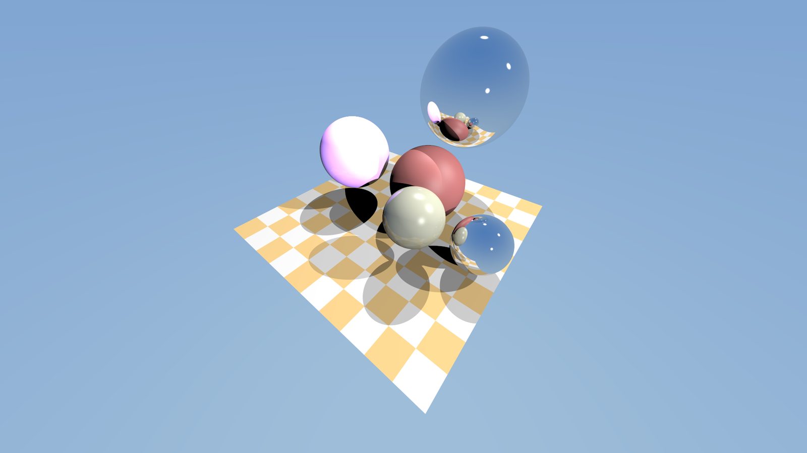

# neraulGraphics

A raytracing rendering engine for games and simulation, usable as a library from Python or
C++. It runs on an NVIDIA GPU through CUDA when there is one, and on the CPU everywhere else.
Actively developed.



Hand it a scene and a camera, get an image back. Every pixel is traced with real
rays, so mirrors, shadows and reflections work without tricks, and the picture
sharpens the longer the camera holds still.

**[Watch the showcase video and see the stress tests](https://aneangel.github.io/neraulGraphics/)**: beauty mode, 100,000 moving instances, thousands of worlds at once, and Newton and MuJoCo scenes, all rendered by the engine itself.

## Features

- **Runs anywhere.** An NVIDIA GPU is used automatically when present; otherwise every CPU core is. Same picture either way, on Linux, macOS and Windows.
- **Library first.** `pip install` and `import neraulgraphics`, or `find_package(neraulgraphics)` in C++. No window or engine to adopt.
- **Meshes and instancing.** Share triangle meshes between any number of instances. Moving an instance only updates a small BVH, so thousands of moving bodies stay cheap.
- **Dynamic scenes.** `set_instance_transforms()` takes a pose per instance each frame, with poses as position plus `(x, y, z, w)` quaternion, the convention Warp, MuJoCo and Newton use.
- **Thousands of worlds at once.** `BatchRenderer` draws many independent worlds, each with its own camera, in one call: over a million 64x64 images a second, with poses straight from the simulator's GPU state and images straight to the policy.
- **Sensors for robotics and RL.** Depth, surface-normal and object-ID (segmentation) images, and ray queries for LiDAR and range sensors, handed to PyTorch, JAX or Warp on the GPU with no copy.
- **Load models.** `ng.load("model.glb")` reads glTF, GLB and OBJ with materials, colour textures, smooth normals and node hierarchies.
- **Newton and MuJoCo adapters.** `NewtonRenderer(model).render(state)` and `MuJoCoRenderer(model).render(data)`: shapes become instances once, and each frame only poses are updated.
- **Reflections, soft shadows, anti-aliasing**, plus progressive refinement while the camera is still.
- **Beauty mode.** Path tracing with physically based materials (roughness, metallic, emission), light that bounces between surfaces, soft shadows, and sky or HDRI lighting with importance sampling, denoised so a few samples per pixel look clean. One call to switch on, and the classic renderer is still there for speed.
- **Interactive viewer** with free-fly camera: `make raytracer`.
- **Clear errors.** Bad scenes raise `ValueError` (Python) or `std::invalid_argument` (C++) saying what is wrong, instead of crashing.

## Install

```bash
pip install neraulgraphics
```

That installs a prebuilt wheel: Linux x86_64 with the GPU backend (needing only the NVIDIA
driver, and using the CPU if there is no GPU), or CPU-only for macOS (Apple Silicon), Windows and
Linux aarch64. On any other platform it builds from source, which needs CMake and a C++17 compiler;
if the CUDA toolkit is installed it also builds the GPU backend for your card, and if not, the CPU
backend, which needs nothing else. For the latest unreleased code:
`pip install git+https://github.com/aneangel/neraulGraphics`.

`neraulgraphics.cuda_available()` says whether a GPU will be used, and
`ng.Renderer(..., device="cpu")` forces the CPU. At 1280x720 a 16-core CPU renders a
138,000-triangle model in about 17 to 41 ms; a GPU takes under 1 ms.

## Quick start

```python
import neraulgraphics as ng

red = ng.Material(diffuse_color=(0.6, 0.15, 0.15))
renderer = ng.Renderer(
    800, 450, spheres=[],
    lights=[ng.Light((-10, 20, 10), intensity=1.6, radius=1.0)],
    floor=ng.Plane(y=-2, half_extent_x=12, z_min=-30, z_max=-2),
    meshes=[ng.make_icosphere(1.0)],
    instances=[ng.Instance(0, ng.make_transform((0, 0, -8), scale=2.0), red)],
)
camera = ng.make_camera((0, 1, 0), (0, 0, -8), width=800, height=450)

for frame in range(64):                  # more frames, smoother image
    image = renderer.render(camera, frame)   # (450, 800, 3) uint8 numpy array
```

Move things every frame with `renderer.set_instance_transforms(matrices)`, an
`(N, 3, 4)` float array, then render with `frame=0`.

## Thousands of worlds for reinforcement learning

```python
renderer = ng.BatchRenderer(64, 64, world_count=4096, meshes=meshes, instances=robot_and_objects, lights=lights)
renderer.set_instance_transforms(poses)                    # (4096, instances, 3, 4): NumPy, or a CUDA tensor
images = renderer.render(cameras, fov=1.0, depth=True, zero_copy=True)   # (4096, 64, 64, ...) CUDA tensors
```

Every world holds the same instances, placed differently, and a camera sees only its own world, so worlds
can overlap in space as simulators leave them. Poses, cameras and rays can be CUDA arrays and are used where
they are; the trees over the instances are rebuilt on the GPU every update (0.15 ms for 80,000 instances), and
`set_body_poses` composes a simulator's body poses with each shape's offset and scale in one kernel. On an RTX
5090, 4,096 worlds at 128x128 (RGB, depth and object IDs, with new poses every step) take about 6 ms, and at
64x64 a million images a second. The adapters do this for the simulators directly:

```python
from neraulgraphics.newton import NewtonBatchRenderer           # Newton, after builder.replicate(robot, world_count=N)
from neraulgraphics.mujoco import MJWarpBatchRenderer           # MuJoCo Warp, with nworld=N

view = NewtonBatchRenderer(model, 64, 64)
images = view.render(state, depth=True, zero_copy=True)          # state.body_q is read where it is, on the GPU
```

See [examples/batch_render.py](https://github.com/aneangel/neraulGraphics/blob/main/examples/batch_render.py)
for the whole data path with PyTorch.

## Beauty mode: path-traced pictures

The classic renderer is fast and what a policy usually wants. When a picture is for a person (a paper,
a demo, a dataset that should look real) switch to path tracing:

```python
renderer.set_render_mode(ng.RenderMode.PathTraced, ng.PathTracing(bounces=4))
renderer.set_environment(ng.Environment(map=ng.procedural_sky(sun_elevation=0.9, sun_strength=3.0)))  # or ng.load_hdr("sky.hdr")
for frame in range(32):          # hold the camera still and the picture keeps refining
    image = renderer.render(camera, frame)
```

- **Materials.** `Material(roughness=, metallic=, emission=)` are the physically based parameters. A material
  written for the classic renderer needs none of them: roughness and metallic are worked out from its specular
  exponent and reflectivity.
- **Light.** Lights are soft when their radius is above 0. The sky lights the scene from all sides: a gradient, or
  an equirectangular HDR map whose sun is sampled directly, so it casts clean shadows at a few samples per pixel.
  Set `Environment(up=(0, 0, 1))` for a Z-up simulator; the adapters do it for you with `sim.beauty()`.
- **Denoising.** On by default: the previous frame is reprojected along the camera's motion and a spatial filter
  steered by normals, depth and brightness smooths what is left. It follows a moving camera; a moving object leaves a
  short trail. `PathTracing(denoise=False)` gives the plain average, which converges to the same picture.
- **Viewer.** `./raytracer --beauty`, or press `B` while it runs.

Batched worlds draw in the classic way.

## Sensors: depth, segmentation, LiDAR

```python
out = renderer.render_frame(camera, rgb=True, depth=True, normals=True, object_ids=True)
out["depth"]        # (H, W) float32, along the view axis, inf where nothing is hit
out["object_ids"]   # (H, W) int32: ng.OBJECT_NONE, OBJECT_SPHERE + i, OBJECT_FLOOR, OBJECT_INSTANCE + i
hits = renderer.cast_rays(origins, directions, max_distance=30.0)   # (N, 3) arrays: a LiDAR sweep
hits["distance"], hits["normal"], hits["object_id"]
```

Depth, normals and IDs are one exact ray through each pixel's middle, so object edges are not blurred
into false depths, and asking for fewer images is faster (a depth-only frame does no shading). On a GPU,
`zero_copy=True` returns the images where they already are, as CUDA arrays for the next library, with
nothing copied:

```python
out = renderer.render_frame(camera, depth=True, object_ids=True, zero_copy=True)
depth = torch.from_dlpack(out["depth"])     # a torch.cuda tensor; also jax.dlpack, warp.from_dlpack, cupy
hits = renderer.cast_rays(origins_tensor, directions_tensor)   # torch tensors in, CUDA arrays out
```

These views are overwritten by the next render, so use or `.clone()` them first. In a quick test at
1280x720, depth-only frames ran about 26 times faster this way than copied to NumPy; the scene was
trivial, so treat that as the saving from the copies, not a benchmark. The Newton and MuJoCo adapters have
the same `render_frame`, plus `update(state)` to place the shapes for a ray query without drawing, and
tell you which object ID is which shape. See
[examples/sensor_images.py](https://github.com/aneangel/neraulGraphics/blob/main/examples/sensor_images.py).

## Loading a model

```python
scene = ng.load("duck.glb")              # .glb, .gltf or .obj
image = scene.renderer(1280, 720).render()
```

The renderer picks a camera and lights from the model's size; `view.camera(position)`
takes over the camera. For more control, hand `scene.meshes`, `scene.instances` and
`scene.textures` to `ng.Renderer` yourself. Reading texture images needs Pillow
(`pip install neraulgraphics[images]`). Not supported: animation and skinning (a
skinned model draws in its bind pose), normal and roughness maps, transparency,
Draco-compressed glTF. See [examples/view_model.py](https://github.com/aneangel/neraulGraphics/blob/main/examples/view_model.py) for a turntable.

## Rendering a simulation

```python
from neraulgraphics.newton import NewtonRenderer          # or neraulgraphics.mujoco.MuJoCoRenderer

view = NewtonRenderer(model, 1280, 720)                   # shapes become mesh instances, once
for _ in range(steps):
    solver.step(state_0, state_1, control, contacts, dt)
    image = view.render(state_1)                          # (720, 1280, 3) uint8; only poses are read
```

It draws spheres, boxes, capsules, cylinders, cones, ellipsoids, planes and meshes, with the
colours the model gives them, and frames the scene and lights it for you. Pass your own
`camera=` (from `view.camera(position, target)`) or `lights=` to take control. A real
articulated humanoid renders in under a millisecond a frame. Runnable versions are in
[examples/](https://github.com/aneangel/neraulGraphics/blob/main/examples/).

C++:

```cmake
find_package(neraulgraphics 0.4 REQUIRED)
target_link_libraries(my_app PRIVATE neraulgraphics::core)
```

```cpp
#include <neraulgraphics/renderer.h>
neraulgraphics::Renderer renderer(width, height, spheres, lights, floor, meshes, instances);
const uint32_t *pixels = renderer.render(camera, frame, 1);   // ARGB, width*height
```

## Build and run

```bash
make raytracer                         # builds ./raytracer
./raytracer --instances 5000           # viewer with 5000 spinning bodies
./raytracer --mode depth               # see what a depth camera sees (keys 1-4 switch: rgb, depth, normals, ids)
make test                              # needs a GPU
```

Needs CMake 3.28+, a C++17 compiler and SDL2. If CUDA 12+ is installed the viewer uses your
GPU (built for RTX 50-series by default; `make raytracer CMAKE_ARGS="-DCMAKE_CUDA_ARCHITECTURES=native"`
for other cards), and otherwise it renders on the CPU. `-DNERAULGRAPHICS_CUDA=OFF` skips CUDA
even when it is installed.

## Status

Pre-1.0: the API may change between minor versions (see the [changelog](https://github.com/aneangel/neraulGraphics/blob/main/CHANGELOG.md)).
Planned next: GPU-side instance updates for 100k+ moving bodies, texture mip-mapping, and
backends for AMD, Intel and Apple GPUs (see [portability](https://github.com/aneangel/neraulGraphics/blob/main/docs/portability.md)).

More detail, benchmarks and viewer controls are in the [guide](https://github.com/aneangel/neraulGraphics/blob/main/docs/guide.md).

## License

[Apache-2.0](https://github.com/aneangel/neraulGraphics/blob/main/LICENSE).

## Credits

Grew out of [ssloy/tinyraytracer](https://github.com/ssloy/tinyraytracer).
